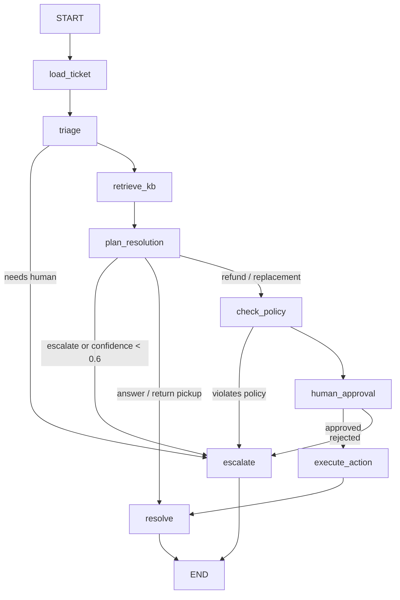

# 05 · Customer Support Agent

An agent that works real support tickets from the `support_tickets` table, end to end: triage → knowledge base → plan → policy check → **human approval** for money or replacements → resolve or escalate. Every step is written to an audit trail.

Six realistic tickets are seeded: a late delivery, a defective product (warranty), a double charge (refund), an address question, an angry enterprise customer threatening legal action, and a return request.

## Database setup (Supabase)

1. Open your project in the [Supabase Dashboard](https://supabase.com/dashboard) → **SQL Editor** → **New query**.
2. Paste the SQL from each step below, in order, and click **Run**. "Success. No rows returned" means it worked.
3. Run the verify query at the end.

All statements are idempotent (`if not exists`, `on conflict do nothing`), so running them twice never duplicates data. The same SQL is part of [`supabase/schema.sql`](../supabase/schema.sql), which sets up **all six modules at once**; if you have already run that, skip this section.

**Step 1: shared tables** (`customers`, `products`, `orders`). Skip if you already created them for another module; re-running is harmless.

<details>
<summary>Show SQL: shared tables + sample data</summary>

```sql
create table if not exists customers (
    id bigint generated by default as identity primary key,
    name text not null,
    city text not null,
    email text
);
alter table customers add column if not exists plan text not null default 'basic';
alter table customers add column if not exists created_at timestamptz not null default now();
create unique index if not exists customers_email_key on customers (email);

insert into customers (name, city, email, plan) values
    ('Rahul',  'Delhi',     'rahul@example.com',  'premium'),
    ('Priya',  'Mumbai',    'priya@example.com',  'basic'),
    ('Amit',   'Pune',      'amit@example.com',   'basic'),
    ('Sneha',  'Bengaluru', 'sneha@example.com',  'premium'),
    ('Vikram', 'Chennai',   'vikram@example.com', 'enterprise'),
    ('Ananya', 'Hyderabad', 'ananya@example.com', 'basic'),
    ('Karan',  'Delhi',     'karan@example.com',  'premium'),
    ('Meera',  'Kolkata',   'meera@example.com',  'basic')
on conflict (email) do update set plan = excluded.plan;

create table if not exists products (
    id bigint generated by default as identity primary key,
    sku text not null unique,
    name text not null,
    category text not null,
    price numeric(10, 2) not null
);

insert into products (sku, name, category, price) values
    ('SW-X1',    'SmartWatch X1',               'Wearables',   4999),
    ('EB-PRO',   'Wireless Earbuds Pro',        'Audio',       2999),
    ('SPK-MINI', 'Bluetooth Speaker Mini',      'Audio',       1999),
    ('LS-STD',   'Laptop Stand',                'Accessories', 1499),
    ('HUB-7',    'USB-C Hub 7-in-1',            'Accessories', 2499),
    ('NC-HP',    'Noise Cancelling Headphones', 'Audio',       8999),
    ('FB-LITE',  'Fitness Band Lite',           'Wearables',   1799),
    ('KB-MECH',  'Mechanical Keyboard',         'Accessories', 3999)
on conflict (sku) do nothing;

create table if not exists orders (
    id bigint generated by default as identity primary key,
    order_number text not null unique,
    customer_id bigint not null references customers (id),
    product_id bigint not null references products (id),
    quantity int not null check (quantity > 0),
    total numeric(10, 2) not null,
    status text not null check (status in ('placed', 'shipped', 'delivered', 'cancelled', 'returned')),
    order_date date not null
);

-- Orders are inserted by email / SKU so the ids resolve correctly in any database.
insert into orders (order_number, customer_id, product_id, quantity, total, status, order_date)
select v.order_number, c.id, p.id, v.qty, p.price * v.qty, v.status, v.order_date::date
from (values
    ('ORD-1001', 'rahul@example.com',  'SW-X1',    1, 'delivered', '2026-08-02'),
    ('ORD-1002', 'priya@example.com',  'EB-PRO',   1, 'delivered', '2026-09-28'),
    ('ORD-1003', 'amit@example.com',   'HUB-7',    2, 'delivered', '2026-08-15'),
    ('ORD-1004', 'sneha@example.com',  'NC-HP',    1, 'delivered', '2026-09-05'),
    ('ORD-1005', 'amit@example.com',   'KB-MECH',  1, 'delivered', '2026-10-01'),
    ('ORD-1006', 'vikram@example.com', 'LS-STD',   5, 'delivered', '2026-08-20'),
    ('ORD-1007', 'ananya@example.com', 'FB-LITE',  1, 'cancelled', '2026-09-12'),
    ('ORD-1008', 'karan@example.com',  'SPK-MINI', 2, 'delivered', '2026-09-18'),
    ('ORD-1009', 'rahul@example.com',  'NC-HP',    1, 'shipped',   '2026-10-14'),
    ('ORD-1010', 'meera@example.com',  'EB-PRO',   1, 'delivered', '2026-08-25'),
    ('ORD-1011', 'vikram@example.com', 'SW-X1',    3, 'placed',    '2026-10-18'),
    ('ORD-1012', 'meera@example.com',  'NC-HP',    1, 'delivered', '2026-10-06'),
    ('ORD-1013', 'sneha@example.com',  'FB-LITE',  2, 'returned',  '2026-08-10'),
    ('ORD-1014', 'karan@example.com',  'KB-MECH',  1, 'shipped',   '2026-10-16'),
    ('ORD-1015', 'priya@example.com',  'SPK-MINI', 1, 'placed',    '2026-10-19')
) as v (order_number, email, sku, qty, status, order_date)
join customers c on c.email = v.email
join products p on p.sku = v.sku
on conflict (order_number) do nothing;

alter table customers enable row level security;
alter table products  enable row level security;
alter table orders    enable row level security;
```

</details>

**Step 2: support tables**: `support_tickets` (6 sample tickets), `ticket_events` (audit trail), `refunds`, `kb_articles` (8 articles) and the `search_kb_articles()` function.

```sql
create table if not exists support_tickets (
    id bigint generated by default as identity primary key,
    customer_id bigint references customers (id),
    order_number text,
    subject text not null,
    body text not null,
    channel text not null default 'email',
    category text,
    priority text,
    sentiment text,
    status text not null default 'open' check (status in ('open', 'resolved', 'escalated', 'closed')),
    resolution text,
    created_at timestamptz not null default now(),
    updated_at timestamptz not null default now()
);

create table if not exists ticket_events (
    id bigint generated by default as identity primary key,
    ticket_id bigint not null references support_tickets (id) on delete cascade,
    event text not null,
    detail jsonb,
    created_at timestamptz not null default now()
);

create table if not exists refunds (
    id bigint generated by default as identity primary key,
    ticket_id bigint references support_tickets (id),
    order_number text not null,
    amount numeric(10, 2) not null check (amount > 0),
    reason text,
    approved_by text not null,
    created_at timestamptz not null default now()
);

create table if not exists kb_articles (
    id bigint generated by default as identity primary key,
    title text not null unique,
    category text not null,
    content text not null,
    fts tsvector generated always as (to_tsvector('english', title || ' ' || content)) stored
);
create index if not exists kb_articles_fts_idx on kb_articles using gin (fts);

insert into kb_articles (title, category, content) values
    ('Tracking a shipped order', 'order_status',
     'Shipped orders arrive in 2-4 business days in metro cities and 4-7 elsewhere. If an order shows shipped for more than 7 business days, open a trace with the courier and offer the customer a free replacement or full refund if it is lost.'),
    ('Returns and refunds', 'return_refund',
     'Unused items in original packaging can be returned within 30 days of delivery. Opened audio products are returnable only if defective. Approve the return, send the prepaid pickup label, and refund the order total within 5-7 business days after inspection.'),
    ('Warranty replacements', 'warranty',
     'All products have a 1-year warranty for manufacturing defects (charging failure, dead units, dead pixels). For a defect reported within warranty, offer a free replacement and arrange pickup of the faulty unit. Physical and water damage are not covered.'),
    ('Duplicate or incorrect charges', 'billing',
     'If a customer reports being charged twice, verify the order total, then refund the duplicate amount (at most one order total) to the original payment method. Refunds for duplicate charges complete in 3-5 business days. Refunds always need a human approver.'),
    ('Changing a delivery address', 'account',
     'Customers can update saved addresses under Account > Addresses. For an order that has not shipped, support can change the address on request. Shipped orders cannot be redirected.'),
    ('Cancelling an order', 'order_status',
     'Orders can be cancelled free of charge until shipped. After shipping, the customer can refuse delivery or start a return.'),
    ('Plan changes and cancellations', 'account',
     'Customers can upgrade or downgrade between basic, premium and enterprise at any time. Enterprise contract cancellations must be handled by the account manager team.'),
    ('Escalation policy', 'complaint',
     'Escalate to a human agent when the customer is angry or threatens legal action, mentions cancelling an enterprise contract, reports a safety issue, or when the request falls outside documented policy. Acknowledge the frustration and give a response time of 4 business hours.')
on conflict (title) do nothing;

create or replace function search_kb_articles(q text, k int default 3)
returns table (id bigint, title text, category text, content text, rank real)
language sql stable as $$
    select a.id, a.title, a.category, a.content, ts_rank(a.fts, query) as rank
    from kb_articles a, websearch_to_tsquery('english', regexp_replace(trim(q), '\s+', ' or ', 'g')) query
    where a.fts @@ query
    order by rank desc
    limit k;
$$;

-- Six sample tickets (only inserted when the table is empty)
insert into support_tickets (customer_id, order_number, subject, body, channel)
select c.id, v.order_number, v.subject, v.body, v.channel
from (values
    ('rahul@example.com', 'ORD-1009', 'Where is my order?',
     'Hi, I ordered noise cancelling headphones on 14 Oct (ORD-1009). It says shipped but I have not received it yet. When will it arrive?', 'email'),
    ('priya@example.com', 'ORD-1002', 'Earbuds stopped working',
     'My Wireless Earbuds Pro from order ORD-1002 stopped charging after two weeks. The left earbud does not turn on at all. Can I get a replacement?', 'email'),
    ('amit@example.com', 'ORD-1005', 'Charged twice',
     'I was charged twice for my mechanical keyboard order ORD-1005. I can see two debits of Rs 3999 on my card statement. Please refund the extra charge.', 'chat'),
    ('sneha@example.com', null, 'Change delivery address',
     'How can I change the delivery address on my account for future orders?', 'chat'),
    ('vikram@example.com', 'ORD-1011', 'Terrible service - cancelling',
     'This is the third time my enterprise order has been delayed. If ORD-1011 is not delivered this week I am cancelling our enterprise contract and talking to my lawyer.', 'email'),
    ('meera@example.com', 'ORD-1012', 'Return headphones',
     'I bought noise cancelling headphones (ORD-1012) on 6 Oct but they are uncomfortable. I would like to return them for a refund. The box is unopened.', 'email')
) as v (email, order_number, subject, body, channel)
join customers c on c.email = v.email
where not exists (select 1 from support_tickets);

alter table support_tickets enable row level security;
alter table ticket_events   enable row level security;
alter table refunds         enable row level security;
alter table kb_articles     enable row level security;
```

**Verify:** run this query; you should see `support_tickets` 6, `kb_articles` 8, `ticket_events` 0, `refunds` 0.

```sql
select 'support_tickets' as table_name, count(*) as row_count from support_tickets
union all select 'kb_articles' as table_name, count(*) as row_count from kb_articles
union all select 'ticket_events' as table_name, count(*) as row_count from ticket_events
union all select 'refunds' as table_name, count(*) as row_count from refunds;
```

<!-- supabase-snapshot:start -->

### See it in Supabase

After running the SQL above:

1. **Create:** left sidebar → **SQL Editor** (`>_` icon) → **New query** → paste the SQL → **Run** (or Ctrl+Enter).
2. **Check:** left sidebar → **Database** → **Tables**, schema **public**. You should see this module's tables: `support_tickets`, `ticket_events`, `refunds`, `kb_articles`.
3. **Browse data:** click a table (or open **Table Editor**, the grid icon) to see its rows; **View columns** lists the column types.

> The dashboard shows rows because you are logged in as the project owner. Row Level Security still blocks the public (anon) key.


<sub>Tables `fin_accounts` … `orders`</sub>


<sub>Tables `hr_policies` … `ticket_events` (19 tables in total; `students` is unrelated to this repo)</sub>

### Table snapshot

Generated from the live database with `python supabase/snapshot_readmes.py`.

#### `support_tickets` · 6 rows

| Column | Type | Notes |
|--------|------|-------|
| `id` | bigint | PK, auto id |
| `customer_id` | bigint | FK → `customers` |
| `order_number` | text |  |
| `subject` | text | required |
| `body` | text | required |
| `channel` | text | default `'email'::text`, required |
| `category` | text |  |
| `priority` | text |  |
| `sentiment` | text |  |
| `status` | text | default `'open'::text`, required |
| `resolution` | text |  |
| `created_at` | timestamp with time zone | default `now()`, required |
| `updated_at` | timestamp with time zone | default `now()`, required |

Sample rows:

| id | customer_id | order_number | subject | status |
|---|---|---|---|---|
| 1 | 1 | ORD-1009 | Where is my order? | open |
| 2 | 2 | ORD-1002 | Earbuds stopped working | open |
| 3 | 5 | ORD-1005 | Charged twice | open |

#### `ticket_events` · 0 rows

| Column | Type | Notes |
|--------|------|-------|
| `id` | bigint | PK, auto id |
| `ticket_id` | bigint | FK → `support_tickets`, required |
| `event` | text | required |
| `detail` | jsonb |  |
| `created_at` | timestamp with time zone | default `now()`, required |

_Empty until the app writes to it._

#### `refunds` · 0 rows

| Column | Type | Notes |
|--------|------|-------|
| `id` | bigint | PK, auto id |
| `ticket_id` | bigint | FK → `support_tickets` |
| `order_number` | text | required |
| `amount` | numeric(10,2) | required |
| `reason` | text |  |
| `approved_by` | text | required |
| `created_at` | timestamp with time zone | default `now()`, required |

_Empty until the app writes to it._

#### `kb_articles` · 8 rows

| Column | Type | Notes |
|--------|------|-------|
| `id` | bigint | PK, auto id |
| `title` | text | unique, required |
| `category` | text | required |
| `content` | text | required |
| `fts` | tsvector | generated (full-text search) |

Sample rows:

| id | title | category |
|---|---|---|
| 1 | Tracking a shipped order | order_status |
| 2 | Returns and refunds | return_refund |
| 3 | Warranty replacements | warranty |

<details>
<summary>Shared tables used by this module: customers, products, orders</summary>

#### `customers` · 8 rows

| Column | Type | Notes |
|--------|------|-------|
| `id` | bigint | PK, auto id |
| `name` | text | required |
| `city` | text | required |
| `email` | text | unique |
| `plan` | text | default `'basic'::text`, required |
| `created_at` | timestamp with time zone | default `now()`, required |

Sample rows:

| id | name | city | email | plan |
|---|---|---|---|---|
| 1 | Rahul | Delhi | rahul@example.com | premium |
| 2 | Priya | Mumbai | priya@example.com | basic |
| 5 | Amit | Pune | amit@example.com | basic |

#### `products` · 8 rows

| Column | Type | Notes |
|--------|------|-------|
| `id` | bigint | PK, auto id |
| `sku` | text | unique, required |
| `name` | text | required |
| `category` | text | required |
| `price` | numeric(10,2) | required |

Sample rows:

| sku | name | category | price |
|---|---|---|---|
| EB-PRO | Wireless Earbuds Pro | Audio | 2999.00 |
| FB-LITE | Fitness Band Lite | Wearables | 1799.00 |
| HUB-7 | USB-C Hub 7-in-1 | Accessories | 2499.00 |

#### `orders` · 15 rows

| Column | Type | Notes |
|--------|------|-------|
| `id` | bigint | PK, auto id |
| `order_number` | text | unique, required |
| `customer_id` | bigint | FK → `customers`, required |
| `product_id` | bigint | FK → `products`, required |
| `quantity` | integer | required |
| `total` | numeric(10,2) | required |
| `status` | text | required |
| `order_date` | date | required |

Sample rows:

| order_number | customer_id | product_id | quantity | total | status | order_date |
|---|---|---|---|---|---|---|
| ORD-1001 | 1 | 1 | 1 | 4999.00 | delivered | 2026-08-02 |
| ORD-1002 | 2 | 2 | 1 | 2999.00 | delivered | 2026-09-28 |
| ORD-1003 | 5 | 5 | 2 | 4998.00 | delivered | 2026-08-15 |

</details>

<!-- supabase-snapshot:end -->

## Graph



| Node | What it does |
|------|--------------|
| `triage` | Structured output: category, priority, sentiment, needs_human. Code rules on top: legal/contract/safety words force escalation, enterprise customers get at least high priority |
| `retrieve_kb` | Full-text search over `kb_articles` |
| `plan_resolution` | Structured output: customer reply, action, order, refund amount, confidence, internal note |
| `check_policy` | Hard rules: order belongs to the customer, refund ≤ order total, replacements only for delivered orders within warranty |
| `human_approval` | `interrupt()` pauses the graph; the CLI shows the proposal and resumes with `Command(resume=...)` |
| `execute_action` | Writes to `refunds` or logs the replacement |
| `resolve` / `escalate` | Update ticket status and resolution, log the event |

## Run

```bash
cd 05_customer_support_agent
python main.py list                  # all tickets
python main.py process               # work every open ticket (asks you to approve refunds)
python main.py process --ticket 3    # one ticket
python main.py show 3                # ticket + full audit trail
python main.py new                   # create a ticket yourself
```

Expected behaviour on the seed tickets (the model may vary):

| Ticket | Likely outcome |
|--------|----------------|
| #1 Where is my order? | Resolved with a delivery-time answer |
| #2 Earbuds stopped working | Replacement → approval → resolved |
| #3 Charged twice | Refund Rs 3,999 → approval → resolved |
| #4 Change delivery address | Resolved with instructions |
| #5 Legal threat, enterprise | Escalated at triage (code rule) |
| #6 Return headphones | Resolved with a return pickup |

Reset the tickets to re-run the demo (Supabase SQL Editor):

```sql
update support_tickets set status = 'open', category = null, priority = null,
       sentiment = null, resolution = null;
delete from ticket_events; delete from refunds;
```

## API

```bash
uvicorn api:app --port 8005      # docs: http://127.0.0.1:8005/docs
```

| Method | Path | Body / params | Returns |
|--------|------|---------------|---------|
| GET | `/tickets` | `?status=open` | Tickets |
| GET | `/tickets/{id}` | | Ticket, customer and audit trail (`events`) |
| POST | `/tickets` | `{"email", "subject", "body", "order_number"}` | `ticket_id` |
| POST | `/tickets/{id}/process` | | `status`: resolved / escalated / **needs_approval** (with `thread_id` and `approval_request`) |
| POST | `/approvals/{thread_id}` | `{"approved": true, "reviewer": "lead", "note": ""}` | Final result after the human decision |
| GET | `/health` | | `{"status": "ok"}` |

Approval flow: `POST /tickets/3/process` → `needs_approval` with a refund proposal → `POST /approvals/<thread_id>` with `approved: true` → `resolved`, and a row is added to `refunds`.

## What to learn from it

- **Human-in-the-loop** with `interrupt` + checkpointer + `Command(resume=...)`.
- Letting the LLM *propose* while code *disposes*: confidence thresholds and policy gates decide what actually happens.
- An append-only audit log (`ticket_events`) for every decision.
