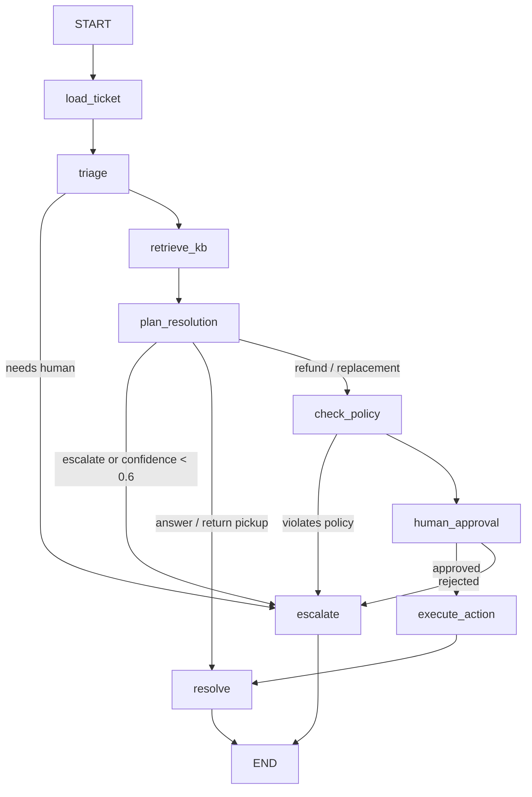

# 05 · Customer Support Agent

An agent that works real support tickets from the `support_tickets` table, end to end: triage → knowledge base → plan → policy check → **human approval** for money or replacements → resolve or escalate. Every step is written to an audit trail.

Six realistic tickets are seeded: a late delivery, a defective product (warranty), a double charge (refund), an address question, an angry enterprise customer threatening legal action, and a return request.

## Graph



| Node | What it does |
|------|--------------|
| `triage` | Structured output: category, priority, sentiment, needs_human. Code rules on top: legal/contract/safety words force escalation, enterprise customers get at least high priority |
| `retrieve_kb` | Full-text search over `kb_articles` |
| `plan_resolution` | Structured output: customer reply, action, order, refund amount, confidence, internal note |
| `check_policy` | Hard rules: order belongs to the customer, refund ≤ order total, replacements only for delivered orders within warranty |
| `human_approval` | `interrupt()` pauses the graph; the CLI shows the proposal and resumes with `Command(resume=...)` |
| `execute_action` | Writes to `refunds` or logs the replacement |
| `resolve` / `escalate` | Update ticket status and resolution, log the event |

## Run

```bash
cd 05_customer_support_agent
python main.py list                  # all tickets
python main.py process               # work every open ticket (asks you to approve refunds)
python main.py process --ticket 3    # one ticket
python main.py show 3                # ticket + full audit trail
python main.py new                   # create a ticket yourself
```

Expected behaviour on the seed tickets (the model may vary):

| Ticket | Likely outcome |
|--------|----------------|
| #1 Where is my order? | Resolved with a delivery-time answer |
| #2 Earbuds stopped working | Replacement → approval → resolved |
| #3 Charged twice | Refund Rs 3,999 → approval → resolved |
| #4 Change delivery address | Resolved with instructions |
| #5 Legal threat, enterprise | Escalated at triage (code rule) |
| #6 Return headphones | Resolved with a return pickup |

Reset the tickets to re-run the demo (Supabase SQL Editor):

```sql
update support_tickets set status = 'open', category = null, priority = null,
       sentiment = null, resolution = null;
delete from ticket_events; delete from refunds;
```

## API

```bash
uvicorn api:app --port 8005      # docs: http://127.0.0.1:8005/docs
```

| Method | Path | Body / params | Returns |
|--------|------|---------------|---------|
| GET | `/tickets` | `?status=open` | Tickets |
| GET | `/tickets/{id}` | | Ticket, customer and audit trail (`events`) |
| POST | `/tickets` | `{"email", "subject", "body", "order_number"}` | `ticket_id` |
| POST | `/tickets/{id}/process` | | `status`: resolved / escalated / **needs_approval** (with `thread_id` and `approval_request`) |
| POST | `/approvals/{thread_id}` | `{"approved": true, "reviewer": "lead", "note": ""}` | Final result after the human decision |
| GET | `/health` | | `{"status": "ok"}` |

Approval flow: `POST /tickets/3/process` → `needs_approval` with a refund proposal → `POST /approvals/<thread_id>` with `approved: true` → `resolved`, and a row is added to `refunds`.

## What to learn from it

- **Human-in-the-loop** with `interrupt` + checkpointer + `Command(resume=...)`.
- Letting the LLM *propose* while code *disposes*: confidence thresholds and policy gates decide what actually happens.
- An append-only audit log (`ticket_events`) for every decision.
